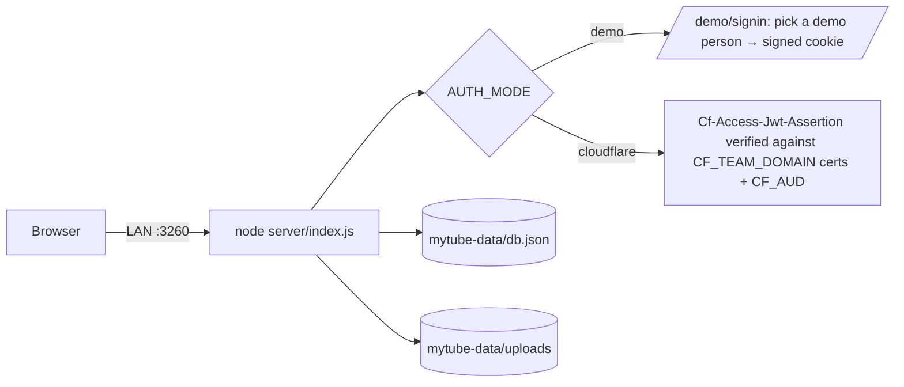

# MyTube demo instance (claude, 5 Nov 2026)

Dev copy of MyTube on agents-vm, branch `claude/demo`, made-up videos only. Not pushed to GitHub (push URL disabled until Daniel says so).

| What | Where |
| --- | --- |
| Address | http://192.168.55.216:3260 (sign in at `/demo/signin`) |
| Service | `app-mytube-demo.service` (server console: "MyTube demo") |
| Code | `/srv/projects/apps/mytube` (server/, client/; `server/public` → `client/dist`) |
| Data | `/srv/projects/apps/mytube-data` (db.json, uploads/, session.secret; 0700) |
| Firewall | 3260 from .109, .134 and NPM .222 only |
| Sample videos | `deploy/make-seed.sh <out>` (all clips generated by ffmpeg) |

## Security fixes in this branch
- Sign-in no longer trusts the `cf-access-authenticated-user-email` header or an unchecked token; Cloudflare tokens are verified (RS256, audience, issuer). The "dev mock" that made everyone admin is gone.
- Videos, thumbnails and the video list need sign-in.
- Uploads: size limit (MAX_FILE_SIZE), video files only, generated file names, bad tags can't crash the server, database re-read after thumbnailing (no lost updates), atomic database writes.
- Listens on HOST (default 127.0.0.1), proxy headers only trusted with TRUST_PROXY=1, basic security headers, short error messages.

## Going behind Cloudflare later
Set `AUTH_MODE=cloudflare CF_TEAM_DOMAIN=bytemypc.cloudflareaccess.com CF_AUD=<app audience tag> TRUST_PROXY=1` and optionally `ADMIN_EMAILS=`.
